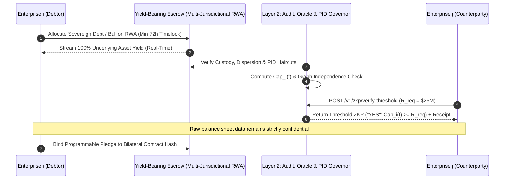
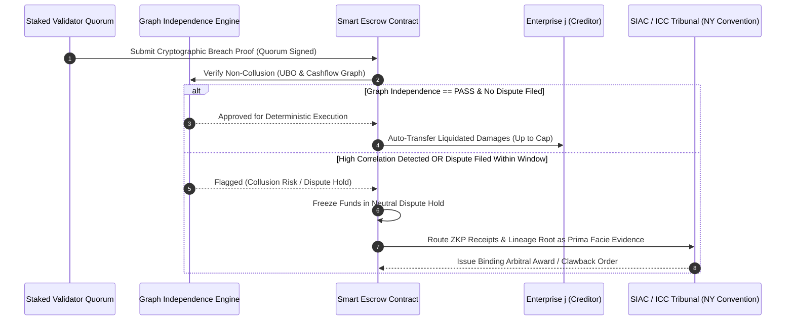

# System Architecture & Adversarial Defense Topology

[*日本語版はこちら (01_architecture.ja.md)*](./01_architecture.ja.md)

## 1. Architectural Overview

The **S-ABS Protocol** is engineered as a four-layer, non-custodial credit attestation and automated settlement infrastructure. Rather than pooling premiums to underwrite correlated risks, S-ABS verifies an entity's **Absorptive Capacity** at the balance-sheet and physical-telemetry levels, enforcing deterministic settlement via commercial contract law and cryptographic proofs.

```
[ Enterprise Balance Sheet / RWAs ]      [ Operational & R&D Telemetry ]
                │                                        │
                ▼ (Time-Lock & Dynamic Lien)             ▼ (Provenance Attestation)
┌─────────────────────────────────────────────────────────────────────────┐
│ LAYER 2: AUDIT, ORACLE & CONTROL LAYER                                  │
│  ├─ Multi-Jurisdictional Asset Verification & Yield Pass-Through        │
│  ├─ Macro-Adaptive Governor (PID Control Loop)                          │
│  ├─ Percolation Concentration Tax & Geopolitical Risk Haircuts          │
│  └─ Demurrage (Half-Life Decay) & Asymmetric Hysteresis Engine          │
└────────────────────────────────────┬────────────────────────────────────┘
                                     │
         ┌───────────────────────────┴───────────────────────────┐
         ▼                                                       ▼
┌─────────────────────────────────────────┐ ┌─────────────────────────────┐
│ LAYER 1: MARKET & CREDIT ATTESTATION    │ │ LAYER 3: LEGAL SETTLEMENT   │
│  ├─ Dynamic Credit Pass (Badge / API)   │ │  ├─ Bilateral Liquidated    │
│  └─ Threshold ZKP (YES/NO Verification) │ │  │   Damages Agreement       │
│                                         │ │  └─ Automated Escrow &      │
│  ──► Reinsurance Actuarial Feeds ──►    │ │      Intl. Arbitration      │
└─────────────────────────────────────────┘ └─────────────────────────────┘
                                     │
                                     ▼ (Systemic Stress Trigger)
┌─────────────────────────────────────────────────────────────────────────┐
│ LAYER 4: CAPITAL & SYSTEMIC BACKSTOP LAYER                              │
│  └─ Protocol SaaS Revenue & Third-Line Liquidity Stabilizer Reserve     │
└─────────────────────────────────────────────────────────────────────────┘
```

---

## 2. Layer-by-Layer Functional Specification

### Layer 1: Market & Credit Attestation Layer
* **Dynamic Credit Pass:** A machine-verifiable credential (JSON-LD / QR / REST endpoint) broadcasting the entity's current solvency tier and active **Deterministic Self-Coverage Cap ($\text{Cap}$)** status.
* **Threshold ZKP (YES/NO Attestation):** Zero-knowledge proof circuits allowing an entity to prove $\text{Cap}_i(t) \ge R_{\text{req}}$ (where $R_{\text{req}}$ is a counterparty's required coverage threshold) without disclosing raw cash balances, asset compositions, or counterparty graphs.
* **Reinsurance Actuarial Feeds:** Standardized risk-telemetry APIs enabling global reinsurers to ingest pre-verified buffer data and empirical failure-reduction metrics to price excess-of-loss (XoL) tail coverage.

### Layer 2: Audit, Oracle & Control Layer
* **Eligible Buffer Verification:** Continuously monitors connected bank accounts (Open Banking APIs), ERP ledgers, and tokenized real-world assets (RWAs) across multiple jurisdictions.
* **Yield-Bearing Escrow:** Locked collateral continues to generate native yields (e.g., sovereign treasury yields, commodity lease returns), with 100% of income streaming directly back to the asset owner in real time.
* **Control & Topology Engines:** Dynamically adjusts effective haircuts and lock durations in response to macro volatility, network hub concentration, and audit freshness.

### Layer 3: Institutional & Legal Settlement Layer (*Lex Mercatoria*)
* **Non-Insurer Positioning:** The protocol operator never acts as a risk bearer, pool manager, or counterparty to compensation claims.
* **Bilateral Liquidated Damages Agreements:** Participating enterprises execute standardized commercial contracts pre-defining objective breach triggers and liquidated damages caps.
* **Automated Execution & International Arbitration:** Upon verified trigger fulfillment, escrow settlement executes deterministically. Disputed edge cases are routed to expedited international commercial arbitration enforceable under the New York Convention.

### Layer 4: Capital & Systemic Backstop Layer
* **Protocol Economics:** Funded via tiered SaaS subscriptions and institutional actuarial query fees, scaled dynamically by enterprise audit volume.
* **Systemic Backstop Reserve:** A segregated third-line liquidity reserve accumulated from protocol surplus to stabilize settlement execution during extreme macro dislocations.

---

## 3. Adversarial Threat Model & 10 Counter-Patches

S-ABS is designed under a zero-trust, adversarial assumption. Below are the 10 primary attack vectors identified through red-teaming and their corresponding architectural counter-patches.

| # | Threat Vector | Attack Mechanism | Architectural Counter-Patch |
| :--- | :--- | :--- | :--- |
| **01** | **High-Frequency Window Dressing** | Temporarily borrowing funds (flash loans / intraday transfers) to inflate balances during API polling, then withdrawing immediately. | **Programmable Time-Lock & Dynamic Lien:** Eligible buffers require a minimum 72-hour lock and cryptographic lien encumbrance while active $\text{Cap}$ commitments are open. |
| **02** | **Sovereign Asset Freeze** | A host government freezes domestic bank accounts or custodians due to sanctions or geopolitical conflict, rendering $\text{Cap}$ uncollectible. | **Multi-Jurisdictional RWA Dispersion:** Prohibits single-country concentration; applies real-time geopolitical risk haircuts that zero out assets in high-freeze jurisdictions. |
| **03** | **Default Contagion (Domino Cascade)** | Entity A defaults, eroding Entity B's receivables and triggering simultaneous credit contraction across hundreds of linked firms. | **Dynamic Counterparty Haircuts & Circuit Breakers:** Receivables are discounted by the debtor's S-ABS score; rapid network-wide score drops trigger automated settlement pacing. |
| **04** | **Oracle Bribery & AI Manipulation** | Colluding insiders or adversarial inputs corrupt ERP/bank feeds or trick valuation models into issuing false `AAA` ratings. | **Threshold ZKP & Validator Slashing:** Verifies cryptographic bank/custodian signatures rather than raw mutable inputs; validator nodes stake collateral subject to 100% slashing upon audit failure. |
| **05** | **Unlicensed Insurance Classification** | Financial regulators classify S-ABS as an unauthorized insurer collecting premiums and paying claims, halting operations. | **Dual-Contract Commercial Structure & Regulator API:** Strictly structured as B2B liquidated damages SaaS; provides free, privacy-preserving macro-risk monitoring APIs to central banks. |
| **06** | **Hyperinflation & Fiat Collapse** | Global monetary crisis causes sovereign bonds and fiat currencies to lose >50% real value simultaneously, wiping out buffer collateral. | **Hard-Asset Priority Weighting:** Assigns superior collateral weights to non-fiat physical infrastructure assets (bullion, energy capacity, data-center power rights, logistics slots). |
| **07** | **Dead-Capital Opportunity Cost** | Enterprises abandon the protocol because locking cash/treasuries for 72+ hours incurs unacceptable working-capital opportunity costs. | **Yield-Bearing Escrow:** Streams 100% of underlying treasury, staking, or commodity yields directly to the depositor during the lock period, eliminating opportunity cost. |
| **08** | **Collusive Sham Disputes** | Entity A and shell Entity B stage a fake contract breach to drain escrowed funds into B prior to A declaring fraudulent bankruptcy. | **Graph Independence Verification & Milestone Release:** Analyzes UBOs, payment graphs, and metadata; high-correlation pairs are barred from instant payout and restricted to audited milestone releases. |
| **09** | **Circuit-Breaker Bank Run** | Participants anticipate an impending circuit breaker and simultaneously withdraw buffers minutes prior, causing a self-fulfilling liquidity run. | **Asymmetric Exit Queue & Jitter:** Enforces randomized cooldown delays (jitter) on buffer releases and keeps circuit-breaker trigger curves non-linear inside `[Foundry Core / Proprietary Calibration]`. |
| **10** | **Adverse Selection in Failure Logs** | Firms submit trivial failure logs to earn buffer discounts while concealing catastrophic engineering defects ("lemon market"). | **Silence Haircut & Retroactive Clawback:** Penalizes statistically anomalous low-failure reporting rates against sector baselines; unlogged real-world failures trigger immediate score collapse and backstop penalties. |

---

## 4. Interdisciplinary Control Mechanisms

Beyond discrete security patches, S-ABS incorporates four continuous dynamic regulators derived from control theory, network science, behavioral economics, and thermodynamics:

### 4.1 Macro-Adaptive Governor (PID Control Loop)
Drawing on Ashby's *Law of Requisite Variety*, static reserve ratios fail under non-stationary market regimes. S-ABS employs a closed-loop **PID Controller** ingesting macro stress telemetry (volatility indices, credit spreads, supply-chain latency):
* **Proportional ($P$):** Scales required buffer haircuts linearly with immediate market stress deviations.
* **Integral ($I$):** Accumulates persistent systemic strain to prevent gradual under-collateralization during prolonged downturns.
* **Derivative ($D$):** Detects rapid acceleration in default velocity (*critical slowing down*), preemptively extending time-lock durations before cascading failures materialize.

### 4.2 Percolation Concentration Tax
In scale-free commercial networks, failure of a single central hub (e.g., a major custodian bank or dominant counterparty) triggers rapid percolation collapse. S-ABS evaluates network topology in real time and applies an exponential **Percolation Concentration Tax** whenever an entity's reliance on a single custodian, jurisdiction, or counterparty exceeds systemic safety bounds—incentivizing organic mesh diversification.

### 4.3 Demurrage & Asymmetric Hysteresis
To prevent post-certification complacency (moral hazard), `Dynamic Credit Pass` scores undergo continuous **Demurrage** (exponential half-life decay $e^{-\lambda \Delta t}$) unless refreshed by verified audit heartbeats and telemetry updates. Furthermore, S-ABS enforces **Asymmetric Hysteresis**: recovering a downgraded rank requires significantly longer lock durations and stricter verification than initial onboarding, leveraging organizational loss aversion to maintain continuous discipline.

### 4.4 Negative Entropy Feedback (Dissipative Metabolism)
Modeled as an open dissipative structure, S-ABS rewards entities that externalize internal operational entropy (R&D failures, near-misses, stress-test anomalies) through **Cryptographic Provenance Oracles** into **R&D Failure Repositories**. Verified failure transparency lowers uncertainty in actuarial modeling, granting a proportional expansion in the entity's effective $\text{Cap}$ via the $\mathcal{F}(\text{Logs}_i)$ multiplier.

*(Note: Specific PID gain coefficients, percolation critical thresholds $N_{\text{crit}}$, demurrage half-life constants $\lambda$, silence-penalty sector distributions, and exit-queue jitter functions are isolated within `[Foundry Core / Proprietary Calibration]`.)*

---

## 5. Protocol Execution Flows (Sequence Diagrams)

### 5.1 Normal Operation: Threshold ZKP Attestation & Yield-Bearing Lock



### 5.2 Breach Event: Deterministic Settlement & Arbitral Dispute Routing

