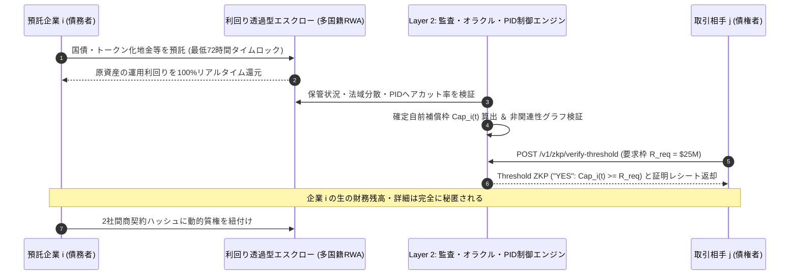
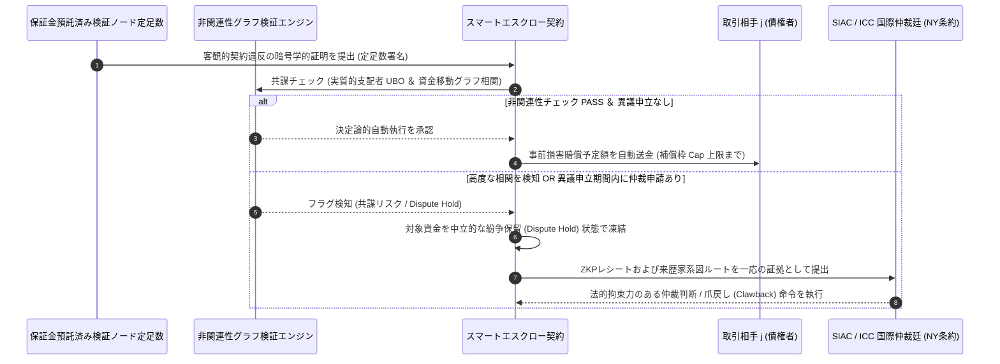

# S-ABS Protocol: システムアーキテクチャおよび防御トポロジー

*[English Version (`01_architecture.en.md`)](./01_architecture.en.md)*

> **文書ステータス**: RFC ドラフト v1.0（Public Tier 1 仕様）  
> **対象範囲**: 4層プロトコル構造、マクロ適応型制御（Macro-Adaptive Control）、および10の敵対的攻撃ベクトルに対する防御トポロジー。

---

## 1. アーキテクチャ概要（4層スタック構造）

**S-ABS Protocol（動的与信バッファー証明プロトコル）**は、保険料をプールして相関リスクを引き受けるのではなく、貸借対照表および物理テレメトリのレベルで企業の**内部リスク吸収能力（Absorptive Capacity）**を検証し、一般商契約法と暗号学的証明によって決定論的清算を執行する4層構造の非カストディ型インフラストラクチャとして設計されている。

```text
[ 企業の貸借対照表 / 多国籍RWA ]           [ 運用・R&Dテレメトリログ ]
                │                                        │
                ▼ (タイムロック ＆ 動的質権)               ▼ (暗号学的来歴証明)
┌─────────────────────────────────────────────────────────────────────────┐
│ LAYER 2: 監査・オラクル・制御層 (AUDIT, ORACLE & CONTROL LAYER)         │
│  ├─ 多国籍法域資産の検証 ＆ 利回り透過型エスクロー (Yield Pass-Through)  │
│  ├─ マクロ適応型PID調律エンジン (Macro-Adaptive Governor)               │
│  ├─ パーコレーション集中ペナルティ ＆ 地政学リスクヘアカット            │
│  └─ 信用スコア自然減衰（半減期） ＆ 非対称回復エンジン                  │
└────────────────────────────────────┬────────────────────────────────────┘
                                     │
         ┌───────────────────────────┴───────────────────────────┐
         ▼                                                       ▼
┌─────────────────────────────────────────┐ ┌─────────────────────────────┐
│ LAYER 1: 市場・信用証明層                │ │ LAYER 3: 制度・法務清算層    │
│  ├─ Dynamic Credit Pass (バッジ / API)  │ │  ├─ 2社間事前損害賠償予定約定│
│  └─ Threshold ZKP (YES/NO 閾値証明)     │ │  │   (一般商法に基づく標準契約)│
│                                         │ │  └─ エスクロー自動執行 ＆   │
│  ──► 再保険数理フィード (Actuarial) ──►  │ │      国際商事仲裁 (NY条約)  │
└─────────────────────────────────────────┘ └─────────────────────────────┘
                                     │
                                     ▼ (システミック・ストレス発動時)
┌─────────────────────────────────────────────────────────────────────────┐
│ LAYER 4: 資本・システミック安全層 (CAPITAL & SYSTEMIC BACKSTOP LAYER)   │
│  └─ プロトコルSaaS・API収益 ＆ 第3防衛線・流動性安定化バックストップ基金 │
└─────────────────────────────────────────────────────────────────────────┘
```

---

## 2. 各レイヤーの仕様詳細

### Layer 1: 市場・信用証明層（Market & Credit Attestation Layer）
* **Dynamic Credit Pass**: エンティティ $i$ に発行される標準化された機械可読クレデンシャル（JSON-LD形式）。有効な確定自前補償枠（$\text{Cap}$）ランク、連続クリーン監査日数、および質権の有効期限を提示する。
* **Threshold ZKP（閾値ゼロ知識証明）**: 企業のリアルタイムな現金残高や財務詳細を取引相手に公開することなく、「当該取引に必要な補償要求額 $R_{\text{req}}$ に対して $\text{Cap}_i(t) \ge R_{\text{req}}$ が成立しているか否か（`YES` / `NO`）」のみを証明する非対話型ゼロ知識証明回路。
* **再保険数理フィード（Reinsurance Actuarial Feeds）**: エンティティの自己吸収枠（$\text{Cap}$）を超えるカタストロフィックなテールリスクについて、超過損害再保険（XoL）の引受料率を算定するため、標準化・監査済みのリスク指標を外部の再保険市場へ供給するインターフェース。

### Layer 2: 監査・オラクル・制御層（Audit, Oracle & Control Layer）
* **テレメトリおよび担保取り込み**: 読み取り専用の Open Banking API、ERP元帳データ、および暗号学的来歴オラクル（Cryptographic Provenance Oracles）が署名した物理資産（RWA）実存証明・R&D運用ログを収集する。
* **ステーキング検証定足数**: 検証ノードはプロトコル上で保証金（ステーク）を預託する。悪意ある共謀や虚偽証明の承認が検知された場合、保証金は決定論的に没収（スラッシング）される。

### Layer 3: 制度・法務清算層（Institutional & Legal Settlement Layer）
* **2社間事前損害賠償予定約定**: 一般商法（契約法）に基づき締結される標準化された契約枠組み。S-ABS運営主体は保険者としてではなく、客観的事実（トリガー条件の成就）を検証する技術SaaSプロバイダとして機能する。
* **自動エスクロー清算および国際商事仲裁**: 客観的な契約違反がオラクル定足数によって検証された場合、エスクロー資金の支払いが自動執行される。紛争が生じた場合は、ニューヨーク条約（1958年）に基づき170以上の法域で法的執行力を有する国際商事仲裁（SIAC、ICC等）へと自動的にルーティングされる。

### Layer 4: 資本・システミック安全層（Capital & Systemic Backstop Layer）
* **プロトコル収益モデル**: エンタープライズ向けSaaSサブスクリプションおよび再保険数理フィードAPIの照会手数料によって維持される。
* **システミック・バックストップ基金**: ネットワーク全体の極端なテールイベント発生時に流動性を安定化させるため、プロトコル収益の一部を積み立てた隔離済みの第3防衛線準備金。

---

## 3. 学際的制御および代謝メカニズム

S-ABSは、従来の保険数理の枠を超え、制御工学・ネットワーク科学・進化生物学・非平衡熱力学の理論を統合した自律防衛メカニズムを備えている。

### 3.1 マクロ適応型PID調律エンジン（Macro-Adaptive Governor）
* **理論的基盤**: サイバネティクスにおける「必要多様性の法則（Law of Requisite Variety）」およびフィードバック制御工学。
* **メカニズム**: 市場全体のストレス指標（ボラティリティ指数、クレジットスプレッド、サプライチェーン遅延ログ等）を偏差 $e(t)$ として連続観測し、PID制御（比例・積分・微分制御）によって「要求バッファー率」「タイムロック時間」「ヘアカット係数」を動的に伸縮させる。
* **境界仕様**: 制御ループの構造式は公開されるが、具体的なPIDゲイン定数（$K_p, K_i, K_d$）および緊急停止閾値は `[Foundry Core / Proprietary Calibration]` にて秘匿管理される。

### 3.2 パーコレーション集中ペナルティ（Percolation Concentration Tax）
* **理論的基盤**: 複雑系ネットワーク科学における浸透理論（Percolation Theory）およびハブ脆弱性分析。
* **メカニズム**: 特定の金融機関、RWA保管機関、または単一取引先の売掛金に対してネットワーク全体の依存度が集中した場合、超過分に対して指数関数的なヘアカット（集中税）を自動適用する。これにより、参加企業には担保・取引先を分散させる経済的インセンティブが働き、ネットワーク全体が単一障害点（SPOF）のない強靭なメッシュ構造へと誘導される。
* **境界仕様**: 臨界集中閾値 $N_{\text{crit}}$ および指数減衰パラメータは `[Foundry Core / Proprietary Calibration]` にて秘匿管理される。

### 3.3 信用スコア自然減衰（デマレージ）と非対称回復（ヒステリシス）
* **理論的基盤**: 進化生物学のハンディキャップ理論（コストを伴うシグナリング）および行動経済学の損失回避性。
* **メカニズム**: 発行された Dynamic Credit Pass は静的ではなく、最新の監査証明や検証済み失敗ログの供給が途絶えた場合、時間経過（$\Delta t$）とともに指数関数的に自然減衰（デマレージ）する。また、不祥事やデータ隠蔽によってランクが失墜した場合、元のランクへ復帰するには新規取得時の複数倍のタイムロック期間を要する非対称な履歴効果（ヒステリシス）を課し、取得後のモラルハザードを抑止する。
* **境界仕様**: 半減期減衰率 $\lambda$ およびヒステリシス倍率は `[Foundry Core / Proprietary Calibration]` にて秘匿管理される。

### 3.4 負のエントロピー還元ループ（Negative Entropy Feedback）
* **理論的基盤**: 非平衡熱力学（散逸構造論）。
* **メカニズム**: 企業がR&Dや業務プロセスで発生した「失敗・ヒヤリハットログ（エントロピー）」を隠蔽せず、暗号学的来歴オラクルで署名した上で外部の R&D Failure Repositories へ提出（排出）することで、ネットワーク全体の事故予防知見が蓄積される。これに対する還元として、提出企業のバッファー要求率が緩和され、確定自前補償枠（$\text{Cap}$）が拡張される。

---

## 4. 敵対的攻撃とカウンターパッチ一覧（脅威モデル v2.0）

| # | 攻撃ベクトル / 脆弱性 | カウンターパッチ（防御機構） | 動作レイヤー |
| :--- | :--- | :--- | :--- |
| **01** | **高周波見せ金・二重担保**<br>（フラッシュローン等による瞬間的な残高偽装） | **プログラマブル・タイムロック**<br>適格バッファー認定に最低72時間の資金固定および動的質権設定を強制。 | Layer 2 / 4 |
| **02** | **国家による資産凍結・接収**<br>（地政学紛争に伴う特定法域の口座凍結） | **多国籍RWA分散と地政学ヘアカット**<br>単一国・単一通貨での保持を禁止し、複数法域のRWAのみを認定。危機指数上昇時は評価額を自動ゼロ化。 | Layer 2 / 4 |
| **03** | **デフォルト連鎖（信用収縮ドミノ）**<br>（取引先破綻に伴う売掛金評価の連鎖暴落） | **動的ヘアカットとサーキットブレーカー**<br>相手先スコアに応じた評価減額を適用し、連鎖低下検知時はネットワーク全体の清算を段階猶予。 | Layer 1 / 2 |
| **04** | **オラクル買収・データ偽装**<br>（検証ノードへの賄賂やAIセンサーハック） | **ZKP検証とステーキング没収**<br>生データではなくZKP署名を検証し、不正見逃し時は検証ノードの預託保証金を全額没収。 | Layer 2 |
| **05** | **無免許保険業としての規制検挙**<br>（金融当局による違法保険認定リスク） | **2社間商契約SaaS構造と当局監視API**<br>運営者は判定SaaSに徹し、資金移動は2社間事前損害賠償約定で執行。当局にはマクロ監視APIを無償提供。 | Layer 3 |
| **06** | **世界同時クラッシュ・ハイパーインフレ**<br>（法定通貨および国債価値の同時暴落） | **ハードアセット優先担保ウェイト**<br>金、エネルギー権益、データセンター給電権、物流インフラ利用権に高い担保評価ウェイトを設定。 | Layer 2 |
| **07** | **資本ロックによる機会損失（デッドマネー化）**<br>（資金拘束コスト増大による優良企業の離脱） | **利回り透過型エスクロー**<br>ロック資産から発生する運用インカムを100%保有企業へリアルタイム還元し、資金拘束コストを相殺。 | Layer 2 |
| **08** | **偽装紛争・自作自演によるエスクロー抜き取り**<br>（結託した2社による計画倒産と資産隠匿） | **非関連性グラフ検証と段階的解放**<br>実質的支配者（UBO）・資金移動グラフの相関が高いノード間の即時一括清算を禁止し、マイルストーン解放へ制限。 | Layer 2 / 3 |
| **09** | **サーキットブレーカー発動前の取り付け騒ぎ**<br>（ロック発動を先読みした一斉資金引き揚げ） | **非対称クールダウン（Exit Queue）**<br>引き出し解除にランダム化された変動遅延時間（ジッター）を課し、引き揚げタイミングの集中を物理的に分断。 | Layer 2 / 4 |
| **10** | **失敗ログの逆選択（チェリーピッキング）**<br>（軽微な失敗のみ提出し致命的欠陥を隠蔽） | **沈黙の減点（未提出ペナルティ）と事後爪戻し**<br>業種ベンチマーク比で提出頻度が不自然に低い企業を減点し、未報告類型の事故発生時は過去遡及でスコア剥奪・違約金執行。 | Layer 1 / 2 |

---

*Note: 本仕様書は公開標準インターフェース（Tier 1）を定義するものである。各防御関数の具体的な重み付け係数、閾値、およびキャリブレーション定数は、逆算攻撃（リバースエンジニアリング）を防止するため `[Foundry Core / Proprietary Calibration]` にて非公開管理される。*

---

## 5. プロトコル実行フロー（シーケンス図）

### 5.1 正常時：Threshold ZKP（閾値証明）および利回り透過ロックのフロー



### 5.2 契約違反発生時：決定論的自動清算および国際商事仲裁ルーティング

